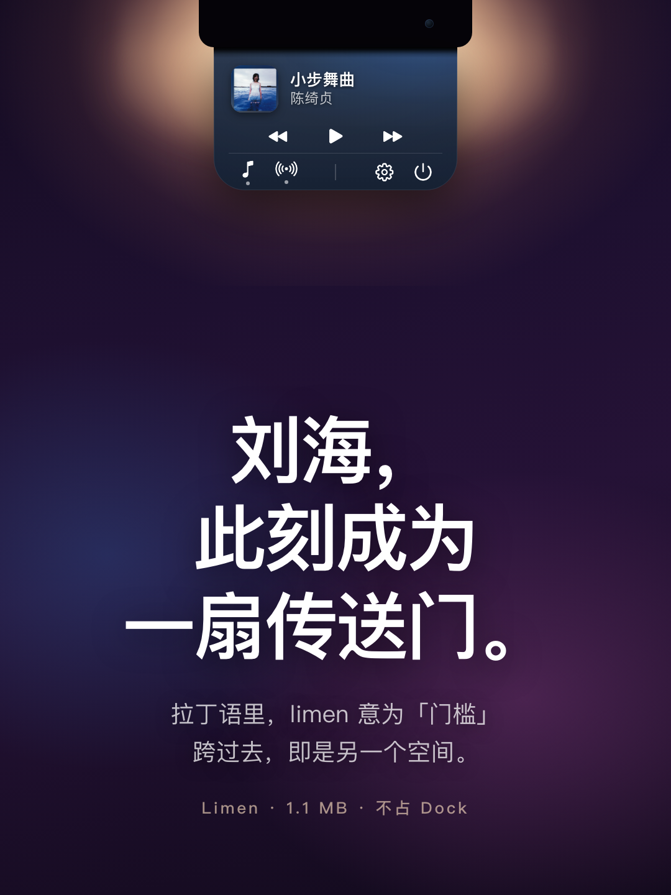
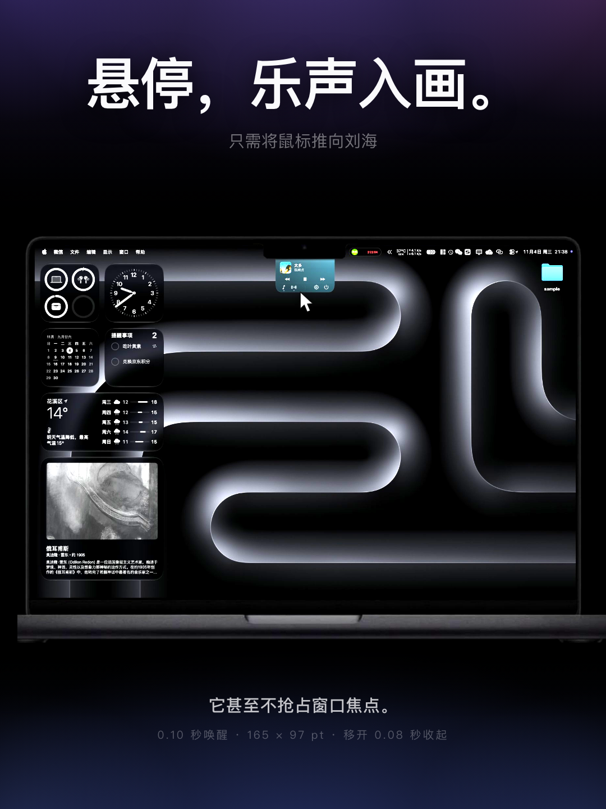
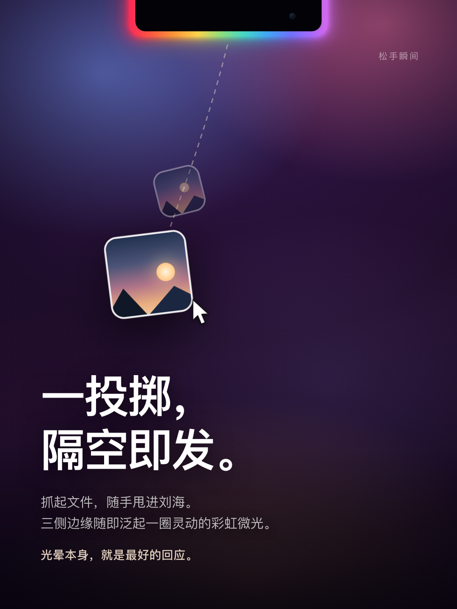
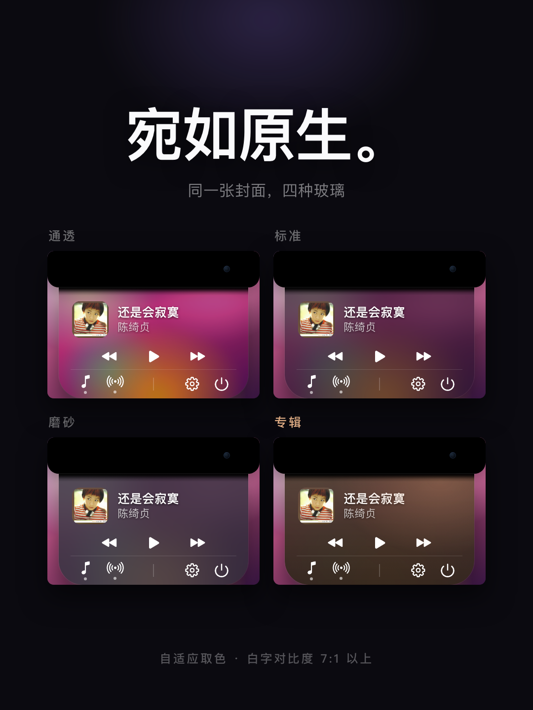
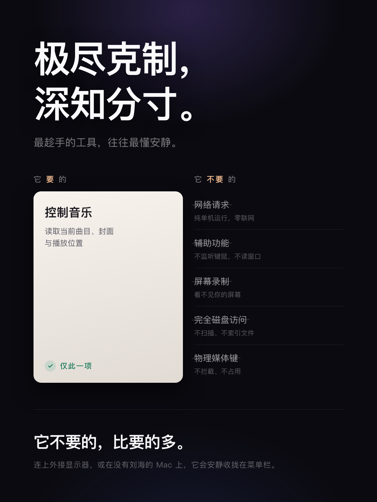
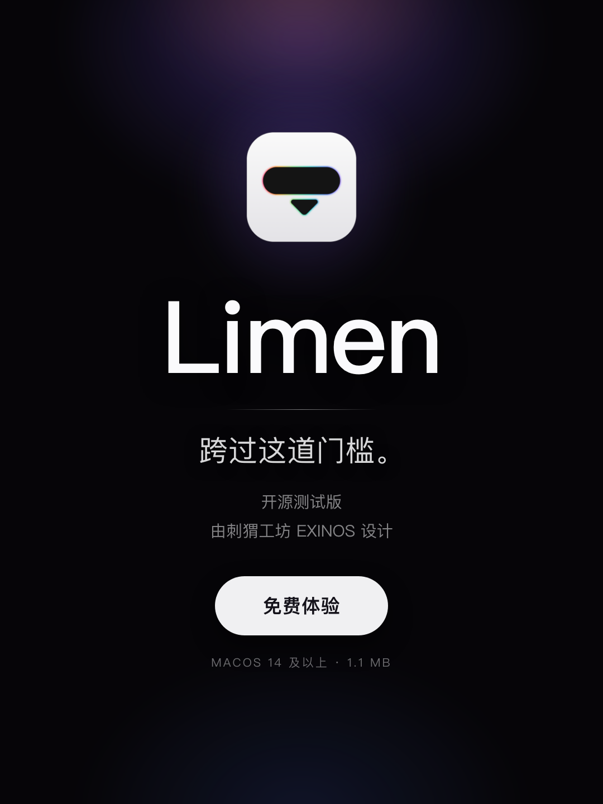

# Limen

把 Mac 刘海变成随叫随到的播放与AirDrop入口。
Turn your Mac's notch into an on-demand player and AirDrop drop zone.

**[⬇ 下载 Limen.dmg / Download · 1.4 MB](https://github.com/xingbeichenxbc-hub/Limen/releases/download/v0.11.2-beta/Limen.dmg)**

| 中文 | English |
|---|---|
| 悬停刘海，展开封面、曲名与切歌；移开即收 | Hover the notch for artwork, track info and playback controls; it retracts when you leave |
| 把文件拖进刘海，直接隔空投送 | Drag a file onto the notch to AirDrop it |
| 刘海边缘倒计时：小光团沿轮廓走一圈，走过的路发光 | Edge countdown: a tiny orb circles the notch, leaving a glowing trail |
| 刘海边缘一条细线标出电量；充电时转白并流动 | A hairline on the notch edge shows battery; it turns white and flows while charging |
| 1.4 MB，纯单机，不联网，不抢焦点 | 1.4 MB, fully offline, never steals focus |

### 0.11.2 新增 / New in 0.11.2

| 中文 | English |
|---|---|
| **边缘倒计时**：点 ⏱ 设 1–1200 分钟，小光团沿刘海轮廓前进并留下琥珀色发光路径；记住最近 6 个时长，进度按墙钟计算，睡眠不中断；到点后光持续亮着，直到手动关闭 | **Edge countdown**: tap ⏱ for 1–1200 min; a small orb travels the notch outline leaving an amber glowing trail. Six recent durations are remembered, progress uses wall-clock time (sleep-safe), and the trail stays lit until you dismiss it |
| **电量光条**：设置页打开后，一条 1.7pt 细线沿轮廓铺开表示 0–100，四档配色渐变，接电转白、正在充时白光流动；全屏应用下隐去，优先级低于光晕与倒计时。默认关，读 IOKit，不需要任何额外权限 | **Battery hairline**: once enabled in Settings, a 1.7pt line maps 0–100 onto the notch outline with four graded colours; it turns white on power and pulses while charging, hides under full-screen apps, and yields to the AirDrop glow and countdown. Off by default; reads IOKit, no extra permissions |

---

<table>
  <tr>
    <td align="center" width="50%"><br>01 封面 / Cover</td>
    <td align="center" width="50%"><br>02 悬停 / Hover</td>
  </tr>
  <tr>
    <td align="center"><br>03 投掷 / AirDrop</td>
    <td align="center"><br>04 原生 / Native</td>
  </tr>
  <tr>
    <td align="center"><br>05 克制 / Restraint</td>
    <td align="center"><br>06 收尾 / Ending</td>
  </tr>
</table>

**beta 0.11.2** · macOS 14+ · Apple Silicon / Intel · [宣传物料 / Promo copy](docs/PROMO.md)

[安装 Install](#安装) · [权限 Permissions](#权限) · [用法 Usage](#用法) · [已知限制 Known Limitations](#已知限制)

---

## 安装

1. 双击 `Limen.dmg`
2. 把 **Limen** 拖进「应用程序」
3. **第一次打开请右键点 Limen → 打开 → 仍要打开**
4. 想开机自启：展开面板 → 齿轮 → 打开「登录时启动」

启动后**没有任何弹窗**：它是静默运行的，把鼠标移到刘海上就会出现面板。
中间没有说明卡，也没有欢迎页——第一次认识它靠的就是刘海本身。

第 3 步不能省：这个 beta 是本地临时签名（ad-hoc），没有经过 Apple 公证。
直接双击会被 Gatekeeper 拦住，提示「无法验证开发者」。右键打开一次之后，
系统会记住这个副本，以后正常双击即可。

> 不要从 DMG 里直接运行。登录项会指向 `/Volumes/...`，重启后卷不在了，
> 自启必然失效。Limen 检测到这种运行位置时会拒绝开启，并提示你先拖进「应用程序」。

---

## 权限

只用到一项系统权限。

| 权限 | 什么时候弹 | 拒绝的后果 | 怎么改 |
|---|---|---|---|
| **自动化 / Apple Events** | 第一次读取「音乐」或 Spotify 时，系统问「Limen 想要控制“音乐”」 | 面板显示「需要允许 Limen 访问音乐」，不显示曲目 | 点这行提示直接跳到设置；或手动去「系统设置 › 隐私与安全性 › 自动化」勾上 Limen |
| **登录项** | 打开「登录时启动」时登记 | 开机不自动运行，其余功能不受影响 | 系统设置 › 通用 › 登录项 |

不需要、也不会请求：

- 辅助功能（Accessibility）
- 屏幕录制
- 完全磁盘访问
- 输入监控
- 摄像头 / 麦克风 / 定位
- 网络访问（应用本身不联网）

关于文件：拖进刘海的路径只是被交给系统的隔空投送服务，Limen 不读取文件内容，
也不会扫描磁盘。选中什么就投什么。

### 全新机器上的完整顺序

```
下载 DMG → 拖进「应用程序」→ 右键打开（绕过 Gatekeeper 首次拦截）
        → 鼠标移到刘海 → 系统问「Limen 想要控制“音乐”」→ 允许
        → 齿轮 → 登录时启动 → 完成
```

第一次读音乐时如果点了「不允许」，系统不会再自动问第二次，必须去设置里手动勾。
这就是提示行做成可点的原因。

---

## 用法

### 两种形态

| 你在哪块屏 | 形态 | 怎么展开 |
|---|---|---|
| 有刘海的屏 | 面板从刘海下方长出，宽度等于刘海底边平直段 | 鼠标移到刘海上，停 0.10 秒 |
| 无刘海屏 / 外接显示器 | 面板挂在菜单栏图标正下方 | 悬停图标 0.22 秒，或点一下图标 |

面板跟着鼠标走。换屏时会自动搬过去；有刘海的屏上，菜单栏图标**不会**弹面板
（避免和刘海抢同一个入口），左键点它出菜单。

### 面板

```
┌───────────────┐
│     刘海       │  32pt（物理挖空，不画东西）
├───────────────┤
│  黑→透明渐变    │   7pt
│  封面  曲名     │  42pt
│        歌手     │
│   ⏮  ⏯  ⏭    │  22pt
├───────────────┤
│ ♪ ⌁ ⏱  │ ⚙ ⏻ │  26pt
└───────────────┘
```

- 点封面 → 打开正在播放的音乐 App
- ♪ 开关音乐读取；⌁ 开关隔空投送；⏱ 倒计时；⚙ 设置；⏻ 退出
- 图标下的小圆点 = 该功能开着
- 设置页三行：四档外观 / 电量显示 / 登录时启动
- 设置页是**临时**的：移开鼠标收起后，下次展开回到主页面
- 菜单栏图标右键 = 同一组开关（外观、登录时启动、电量、音乐、退出）

尺寸：卡片 **165 × 97pt**。收起时窗口只有 **185 × 32pt**——正好等于刘海本身；
展开时才长到 **165 × 129pt**（卡片 + 刘海那一段）。
165 不是刘海宽度（185），是刘海**底边平直段**的长度（185 − 2×10 圆角）。
用满 185 会在两个圆角外侧露出黑角，浅色菜单栏下像贴了一块膏药。

> 为什么窗口要跟着变：窗口是**整块**参与事件路由的。收起时若留着一个
> 209 × 141 的透明窗口，那块区域里所有的点击都会落进 Limen 然后被丢掉——
> 用户看到的就是「鼠标点不动」。视图层的 `hitTest` 返回 nil 并不能把点击
> 让给下面的 App，所以只能让窗口真的不在那里。

### 隔空投送

**把文件拖进刘海本身**（那块黑色缺口里面），不是拖到它下方：

- 光晕贴着刘海左、下、右三条外边亮起，表示「已接住」
- 按住不动：整圈点亮 + 缓慢呼吸 + 一道白光往返
- 松手：短促一亮，然后系统隔空投送窗口出现
- 中途拖出刘海：光晕立刻淡出，光标变回禁止符号

拖拽期间**完全不弹面板**，唯一反馈就是那圈光。这不是省事，是必须——
卡片顶端那 7pt 是「黑→透明」的过渡带，正好压在光晕下沿外侧，
面板一出现就会把彩虹的下边缘啃掉一段。

光晕的下半边落在刘海**外面**，所以它住在一个比刘海宽 24pt 的窗口里。
那个窗口 `ignoresMouseEvents = true`，只画不接事件，因此不会挡住任何点击；
层级也比面板高一级，任何时候都不会被面板盖住。

> 收起态的面板窗口恰好等于刘海（185×32），悬停热区也**恰好等于这个窗口**。
> 热区哪怕多出 1pt，就会出现「拖拽已离开窗口、但鼠标还在热区」的缝，
> 面板会从缝里弹出来盖住光晕。这个不变式是刻意守住的，别随手放宽。

**边界一律按「含」判定。** 鼠标贴着屏幕最上面那一行时，它的 y 恰好等于
窗口顶边，而 `CGRect.contains` 对 maxX / maxY 返回 **false**——于是
「在刘海里」被判成「不在」：光晕当场灭、悬停也不展开。手一甩到屏幕最上方
就空操作，就是这个原因。所以热区、投放区、展开后的活动区全部走
`containsInclusive`（容差 0.5pt，2x 屏上一个物理像素），
不论贴顶边还是贴左右边缘，效果和在中部完全一样。

同样的原因还有一处：展开后的卡片只有 165 宽，刘海有 185，左右各差 10pt。
鼠标停在刘海边缘时卡片并没有盖住它，于是「刚展开就判定离开」，闪一下才收回。
现在刘海本身也算「还在上面」，边缘悬停和中部一样稳定。

> 菜单栏形态下没有刘海可以占位，收起时面板窗口只有 1pt 高，等于不存在。
> 代价是那个形态下不能直接往图标下方拖文件——先悬停展开，再拖进面板。

### 倒计时

功能栏里小时钟图标（⏱）开在隔空投送右边。点它，弹窗切到倒计时页：

- 输入 **1–1200** 的整数（分钟）。超出上限时输入框变红并直接给出最大值
  **1200**；填 0、负数或非数字时输入框标红、不能开始
- 之前用过的分钟数会记住最近 **6** 个，以胶囊形式排在输入行下方，点一下回填
- 右边「开始」按钮（或直接回车）开始计时
- 倒计时页有**自己的专用底**：不透明、随系统明暗，不跟四档外观走。
  其它页面照常用你选的玻璃。这不是偷懒——这页要收键盘输入，面板会临时
  成为 key window，而 key 窗口下所有采样背景的玻璃材质都会变得过于通透、
  文字不可读；专用底与背景无关，对比度恒定

计时不在弹窗里，而在**刘海边缘**：

- 从刘海左上角冒出一个很小的光团，沿轮廓前进直到右上角；前进速度由输入的
  分钟数决定
- 光团每 **2 秒**呼吸一次（scale + 亮度，无频闪），走过的路留下一条窄窄的
  琥珀色发光路径——时间走了多少，抬头一眼就看见
- 走到右上角、路径完整包住刘海时，整条路径「**吸气扩大**」：线宽与柔光
  略微扩散、亮度微升，然后保持发光跃动，直到你来关
- **计时结束后，只有把鼠标移到刘海呼出弹窗、点「关闭计时」才会熄**；
  光还亮着的时候弹窗会一直显示「时间到」
- 计时过程中同样可以悬停展开弹窗，里面只显示剩余时间和「停止」按钮。
  发光路径住在不吃事件的高层级窗口里，弹窗不会遮住它
- 计时中展开弹窗默认停在倒计时页；点 ♪ 切去音乐显示（这一下不改开关，
  再点才是关/开音乐的常规切换），再点 ⏱ 切回倒计时页。移开鼠标，弹窗
  照常自然收回
- 无刘海的外接屏没有边缘可走，倒计时只有弹窗数字，功能不受影响
- 进度按**墙钟时间**计算：机器睡眠不会让倒计时停摆；最长 20 小时

倒计时期间可以直接拖文件隔空投送，彩虹光晕与发光路径互不干扰。

### 电量

设置页第二行「电量显示」打开后，刘海边缘多一条极细的光条。**默认关**：
它是一条常驻的光，默认打开就是在替用户做决定。

- 刻度就是刘海轮廓本身：**左上角是 0，右上角是 100**。光条从左上角起笔，
  铺到哪个位置就是多少电——100% 时刚好绕满整圈闭合，掉电时右端一路往左上退。
  不显示数字：数字满屏都是，而「还剩多少」这件事一条长度就说完了
- 颜色只分四档：**40% 以上绿**、**20–40% 偏黄绿**、**10–20% 黄**、
  **10% 及以下红**。跨档时颜色渐变过去，不「啪」地换
- 接上电源，整条渐变转白；**正在充**时有一段白光沿光条从左往右流
  （3 秒一遍）。满电、或者到达系统设的充电上限而停充，白条留着、脉冲停掉
- 那道光**不是整段平移**：它在左端由一点慢慢长成一段、匀速走完、再收进右端
  消失（详见下面「充电脉冲」）。头尾都从零长度出发，所以看不到「突然出现」
  和「到点闪没」
- 光条只有 **1.7pt** 粗，而且一半埋进物理挖空里，露在外面不到 1pt——
  它应该像玻璃边缘的反光，不是一根进度条
- **一直在轻轻呼吸**：亮度 4 秒一个来回、起伏约 ±30%。不是为了好看，
  是为了「它没坏」——一条完全静止的细线贴在刘海边缘，第一眼会被读成
  渲染残留或者屏幕出了问题
- **优先级最低**：拖文件时的彩虹、倒计时都在这同一条轮廓上画光，
  它们出现时这条整体淡出，等它们退场再浮回来
- **全屏应用占着屏幕时整条隐去**：那会儿刘海落在画面里，一条来历不明的光
  就是干扰。判断靠窗口几何（全屏窗口会顶到屏幕最上沿、把菜单栏一起盖掉），
  不需要辅助功能或屏幕录制
- 无刘海的外接屏没有边缘可画，这个开关在那里不起作用
- 台式机没有内置电池，什么都不画

不需要任何额外权限：电量读的是 IOKit 的电源信息，
既不会弹授权框，也不碰网络。

---

## 设计笔记

### 从刘海长出来

- 展开：spring(response 0.32, damping 0.78)，稍慢、带一点回弹
- 收回：spring(response 0.24, damping 0.95)，更快、更干脆
- 内容不做淡入淡出，完全靠外层形状裁剪来「揭示」，所以看起来是被拉出来，
  而不是一张卡片浮上来
- 顶部 7pt 是纯黑到透明的过渡带，把物理刘海和玻璃接上

### 收回时机

鼠标离开面板后 **0.08 秒**判定收回，另有 **0.30 秒**最短显示时间，
防止快速划过时闪一下。菜单栏形态会把图标本身也算进「还在面板上」，
否则从图标移进面板的那一瞬会被判成离开，来回闪。

页面状态不跨收起保留。设置页只是「进来改一下」的临时去处，
收起后再展开一律回到主页面——那一刻用户要的是曲目，不是上次留下的那一页。

复位挂在**展开**这一侧（`NotchModel.prepareForExpand`），不是收起：
收起可能被「刚移出去又马上移回来」取消，展开才是每次必经的那一步。
而且复位发生在卡片高度还是 0 的时候，换页看不见，不会有内容突变的闪动。

#### 收起最后一瞬间的那块"黑色长方体"

刘海过渡带（`NotchFade`）是一条固定 10pt 的黑色渐变，作用是让物理挖空的刘海
和下方的玻璃之间不要出现硬边。但它靠外层 `clipShape` 裁切——
卡片缩短时，裁剪线从下往上**斜切过这条渐变**：

- 切掉的是渐变最淡的尾巴
- 留下的是渐变最黑的头部

于是最后几帧屏幕上是一块**底边是硬边**的黑色。实测同一列像素：

```
卡片还高： 66:0.07 70:0.27 74:0.52 78:0.74 82:0.88 85:1.00   ← 完整渐变，正常
缩到一半： 66:0.07 70:0.28 73:0.48 74:0.77 75:1.00           ← 4pt，一刀切
快贴底：   66:0.08 67:1.00                                   ← 1pt 纯黑，硬边
```

改法是让过渡带**跟着卡片一起压缩**（`BandClamp`）：
高度取 `min(带宽, 卡片高)`，渐变永远铺满剩余高度，底边始终是透明端。
卡片缩到多小，过渡带就跟着多小，最后和刘海连成一片黑一起收走。

必须是 `Animatable`：`cardHeight` 本身只有 0 和 129 两个值，不插值的话
压缩只会在动画结束时突变一次，比不修还难看。

效果量化（过渡带区间内，相邻两行亮度的最大跳变 = 边缘硬度）：

| | 最差跳变 | 平均 |
|---|---|---|
| 修复前（硬切） | **0.813** | 0.116 |
| 修复后（压缩） | **0.138** | 0.081 |

（这组是 12 倍慢放测的。慢放只拉长时长、不改曲线形状，所以可用；
但它拍不到"真速下只存在一帧"的现象——白边就是那样漏掉的，详见下一节。）

#### 白边：卡片被压扁时露出的白色描边

过渡带压缩修好了"硬边"，但收起时又冒出**一条白边**。真速录屏（25fps）逐帧看得很清楚：

```
f37  … 0.09 0.28 0.28 0.13 0.14 …
f40  … 0.26 0.14 0.14 …      ← 刘海下沿那一行 0.26，背景只有 0.14
f44  … 0.15 0.14 …
```

从出现到消失约 4 帧（0.16 秒），所以是"闪一下"。

**来源不是过渡带，是 `CardSurface` 的白色细节层。** 过渡带的渐变尾端是透明的，
卡片缩到十几 pt 时，那一小段透明露出的就是下方 `thickness` 的 1.8pt 白描边——
描边在 2pt 高的形状上被压成**一条横线**。

修法是 **`squash`（压扁程度）**：卡片高度低于 26pt 开始，到 10pt 时完全淡出，
白色细节（内缘高光、镜面反射、轮廓线）按它衰减，卡片整体也同步淡出
（`opacity(1 - squash * 0.92)`）。

> 关键细节：`cardHeight` 是个计算属性（`expanded ? 129 : 0`），**没有中间值**。
> 直接传给 `CardSurface` 的话，收起一开始它就已经是 0，压扁逻辑根本没机会生效。
> 所以用 `SquashFade`（`View + Animatable`）包一层，由 SwiftUI 插值后逐帧喂进去。

效果（真速录屏，刘海下沿 3pt 内的最大亮线凸起）：

| | 峰值 | 背景 |
|---|---|---|
| 修复前 | **0.123** | 0.14 |
| 修复后 | **0.007** | 0.14 |

深色/浅色外观各测一轮都是 0.007–0.009；展开方向 0.018。

#### 别在这里加 opacity 淡出

第一版修法是"压缩 + 淡出"，结果原速下**白边闪现一帧**，比原来更糟。
原因：黑过渡带一淡下去，就露出它下面那条玻璃顶部内缘高光（`thickness` 里的 0.55 白）。
白底实测紧贴刘海那一行（y=64）从 **0.03 直接跳到 0.23**，整条带从 0.11 涨到 0.58。

**淡出的对象是错的。** 卡片缩回刘海时，顶部本来就该是连续的黑；
让黑变透明等于把最不该露的那一层（玻璃高光）露了出来。

现在只压缩不淡出：y=64 全程 0.020 → 0.059 单调上升，亮线检测最大凸起 **0.004**（约等于无）。

### 专辑配色

选「专辑」这一档后，底色由当前封面取色，换歌自动跟着变。

1. 封面缩到 32×32，逐像素转 HSB
2. 丢掉近黑、近灰的像素（`v < 0.10` 或 `s < 0.16`）
3. 按鲜艳度加权投票到 36 个色相桶
4. 色相桶做环形平滑，避免渐变封面被拆散后让一小块纯色反超
5. 取票数最高的桶的平均色

关键：**只取色相，不直接用主色**。底色亮度被钉在 0.30 / 0.20 的暗区间，
强调色另算。所以封面是纯白、纯黑还是灰度，白字对比度都稳定在 7:1 以上
（小字标准线 4.5:1）。没有封面（Spotify）时自动回退成通透玻璃。

配色只在换曲/换封面时算一次，不参与每 2 秒的轮询。

#### 封面读取为什么要重试

点「下一首」之后，播放器的 current track 会立刻变成新歌，但 artwork
往往要几十到几百毫秒才就绪。那一拍去读只能拿到空数据。

**判定必须「拿到图才算这一首解决了」。** 早前的写法在读失败时也把曲目
记成已解决，于是下一次轮询看到曲目没变就直接跳过读取、把「没有封面」
当成结论返回——封面再也不出现，直到再换一首歌。表现就是
「点下一首没封面，再点几次又有了」。

现在的规则：

- 读失败**不提交**，下一次轮询（2 秒后）继续试
- 同一首最多试 6 次 / 12 秒，之后认定「这首确实没有封面」，停止空转
- 切歌时把重试计数一起清零，上一首的失败次数不能算到下一首头上
- 封面脚本会回传**它当时正在播的曲名**；和刚读到的元数据对不上就不采用，
  避免把 B 歌的封面挂到 A 歌名下
- 切歌命令发出后分 0.35 / 0.9 / 1.6 秒各刷一次，界面不用等满 2 秒

`--selftest` 里有 9 项断言守着这套状态机（含「失败后必须重试」），
不需要播放器也不需要出声。

### 四档玻璃

| 档位 | 实现 |
|---|---|
| 通透 | `glassEffect(.clear)`，透色最强（默认） |
| 标准 | `glassEffect(.regular)`，更实、字更清楚 |
| 磨砂 | `NSVisualEffectView(.popover)`，传统毛玻璃 |
| 专辑 | 通透玻璃 + 封面取色的暗色渐变层 |

macOS 14–15 没有 `glassEffect`，自动回退到 `NSVisualEffectView`。

#### 别再给玻璃盖白膜

`glassEffect(.clear)` 本身是**真的在采样背后的内容**——实测：彩色条纹背景
饱和度 0.71–0.76，透过卡片后仍有 0.21–0.48，且数值随条纹横向起伏。
玻璃没坏，坏的是盖在它上面那层 `Color.white.opacity(0.20)`。

那层白膜的初衷是"保证任何壁纸上文字都读得清"，但它把采样到的颜色和模糊
**一起抹平**了——结果就是一块半透明白板，看着完全没有玻璃感。
上一版「通透模式是假通透」说的就是这个。

现在玻璃的质感由三层叠出来，**一层白膜都不要**：

| 层 | 做法 | 作用 |
|---|---|---|
| 厚度 | 内侧 2.4pt 白描边模糊 + 顶部渐隐蒙版 | 上缘一圈柔光，像玻璃边缘把光吸进去 |
| 厚度（下） | 内侧 2.6pt 黑描边模糊 + 底部渐隐蒙版 | 底部略暗，暗示玻璃有厚度 |
| 镜面反射 | 左上→右下白渐变，`plusLighter` | 被单一光源照到的那道宽而淡的亮带 |

可读性不再靠白膜，改由两件事保证：文字颜色随背景明暗取（见下），
以及底部内阴影给出的轮廓对比。

#### 那条"细细的黑边"：系统窗口投影

卡片四周原本有一圈 1pt 的近黑线。它**不是**我们画的任何一层，
而是 `NSWindow` 系统投影紧贴内容边缘的核心暗环：

| 背景 | 卡片内部 | 那条线 | 背景 |
|---|---|---|---|
| 白色 | 0.78 | **0.12** | 0.87 |
| 深色 | 0.21 | **0.02** | 0.16 |

它属于窗口服务，SwiftUI 层盖不掉——试过关 `masksToBounds`、
把裁剪边内缩、给玻璃加 `bleed`、调大模糊，全都无效。
唯一有效的办法是**整体关掉系统投影**（`panelShouldCastShadow` 默认 false）。

代价是少了悬浮感，所以改成卡片自己在**下缘**画一道柔暗（`CardSurface.shadow`）：
白描边 + 向下偏移 3pt + 5pt 模糊，再裁回形状内部。
关键是**不能 fill + blur**——那会把整块卡片一起压暗（实测 0.78 → 0.66，像蒙了层灰），
描边才有"只在外缘产生暗部"的效果。

> **教训**：`expandNow` 里曾经也写了一句 `p.hasShadow = ...`，
> 把建窗时设的值又覆盖了一遍。结果我用 `LIMEN_NO_SHADOW=1` 做的对照实验
> 完全无效，白白多怀疑了三轮（怀疑过 glassEffect 材质边、裁剪抗锯齿、layer 遮罩）。
> 涉及同一个开关的多处赋值，必须收敛到一处，否则调试会被自己骗。

> 调试开关：`LIMEN_WINDOW_SHADOW=1` 把系统投影开回来做对比；
> `LIMEN_APPEARANCE=dark|light` 强制外观；`LIMEN_DARK_BACKDROP=1` 把演示背景换成深灰。

#### 文字不要加黑晕

`legibleOnGlass` 原先是两层黑色阴影当描边（radius 1.6 / 0.4）。
在深色卡片上没事，可一旦卡片是浅色、文字也是深色，这圈黑晕就贴在笔画外面，
**等于把每个字都涂厚了一圈**——浅色模式下"字看着糊"就是这个。

现在按背景明暗分开：深色底留一层很紧的阴影（radius 0.9）帮白字提分离；
浅色底**完全不加阴影**，浅底深字本身就有 8:1 以上对比度，加阴影只会弄脏。

实测同一处标题笔画的剖面：旧版笔画之间的纸面被阴影压到 0.70–0.82，
新版回到 0.90–0.92，中间灰裙宽从 3px 收到 2px。

### 充电脉冲

一小段白光沿光条从左往右走，只走**有电的那一段**——跑到空段上就等于在骗人。

关键在它怎么进出：

```
0 ──0.18── 由点长成一段（左端钉住，右端伸展）
   ──0.82── 定长匀速行进（两端同速，长度不变）
   ──1.00── 收进右端（右端钉住，左端追上来）
```

头尾都以**零长度**为起点和终点，所以它在左端是长出来的、在右端是收进去的。
早先是「一段固定长的光整体平移」，于是每一圈都会在左端整段冒出、到右端整段
消失——两下都是硬切，余光里就是闪。

亮度另有一条 0 → 满 → 0 的包络（同一条 keyframe），两头再柔一层。

电量上涨会重排动画（终点变了），但**相位要接上**：按已经跑过的时长把
`beginTime` 往前推同样的量，所以每涨 1% 不会让光跳回左端重来。

要逐帧看这两段，用 `LIMEN_PULSE_SLOW=10` 把行程拉长十倍；
`LIMEN_PULSE_TRACE=1` 则每 0.1 秒把动画当前值打进日志
（`start` / `end` / 宽度 / 透明度）——壁纸亮、刘海贴屏幕顶边时，
截图里那条白线的形状几乎无法用像素判定，读动画值才靠得住。

### 彩虹光晕

刘海是物理挖空，里面没有像素，所以光晕只能描在外面。轨迹中心线**压在刘海边缘上**，
一半埋进挖空、一半露出来——这样 ±1pt 的几何误差不会在边缘漏出一条背景缝。

三层描边叠出灯管感：

| 层 | 线宽 | 透明度 |
|---|---|---|
| 外弥散 | 14 | 0.10 |
| 过渡 | 7 | 0.34 |
| 本体 | 3 | 0.96 |

用 Core Animation 而不是 SwiftUI：拖动会话期间系统在跑拖放循环，SwiftUI 的
显示刷新会被推迟，状态改了画面不跟——之前「动画完全不生效」就是这个原因。
CA 动画由渲染服务推进，与 app 主循环无关。

呼吸周期 1.5 秒，亮度在 0.60–1.00 之间起伏，**不做频闪**：
320ms 内闪两次约 6–8Hz，落在光敏性癫痫的高风险区间，Apple HIG 也要求每秒不超过 3 次。

光晕画在一个独立窗口里（209×44，比刘海宽 24pt 用来容纳外弥散），
那个窗口 `ignoresMouseEvents = true`、层级比面板高一级。两个原因：

1. 面板窗口必须严格等于刘海，不能为了光晕放大——放大出来的那圈是点击死区；
2. 光晕的下半边落在刘海**外面**，面板一旦在它上面就会啃掉彩虹的下边缘。

### 菜单栏形态

系统只把第三方状态栏项画在**当前活动显示器**上，焦点换屏时图标会搬家。
所以图标只建一次，位置每 40ms 重读一次（状态栏窗口建立得比启动晚，
刚建立时 frame 还可能是 `(0, -33)` 这样的坏值，要过滤掉）。

面板水平居中于图标，顶边紧贴菜单栏下沿。图标靠近屏幕边缘时向内收，
优先保证完整可见。

### 判断有没有刘海

不看机型字符串——那对外接屏、合盖、以后的新机型都不成立。用几何特征：
系统会把顶部两侧划成 `auxiliaryTopLeftArea` / `auxiliaryTopRightArea`，
两者之间剩下的就是缺口；再用 `safeAreaInsets.top ≥ 20` 和缺口宽度 120–320pt 校验。

### 开机自启

用 `SMAppService.mainApp`，登记进系统「登录项」。不写 `~/Library/LaunchAgents`
里的 plist——那个位置用户看不见，应用删了还会留下一条失效启动项。

三种失败都会当场说清楚，而不是等下次开机才发现没启动：

- 从 DMG / 临时转写目录运行 → 直接拒绝，提示先拖进「应用程序」
- 系统要求用户批准 → 提示并给出「打开登录项设置」按钮
- 其它错误 → 显示系统给的原因，开关回到真实状态

开关的状态不存 UserDefaults，唯一可信来源是系统登录项；每次展开面板都重读一次，
用户去系统设置里改过也能跟上。

### 屏幕与合盖

合盖、没有外接屏、又刚好开机自启时，启动那一刻可能一块屏都没有。
直接取 `NSScreen.screens[0]` 会越界崩溃，而一个后台小组件崩溃是完全无声的。
现在会等屏幕出现再建面板，每秒重试。

---

## 已知限制

- **没有公证**：首次打开被 Gatekeeper 拦，需要右键打开一次。要分发给别人，
  得用 Developer ID 签名并公证（需要 Apple Developer 账号）。
- **自动化授权与签名绑定**：每次重新编译，cdhash 变了，系统会重新问一次
  「是否允许控制音乐」。分发给别人的固定版本不会反复问；只有自己改代码重编才会。
- **播放器优先级**：Music 和 Spotify 同时播放时，显示 Music。
- **Spotify 没有封面**：AppleScript 不暴露封面，所以「专辑」档会回退成玻璃。
- **不做媒体键拦截、不做通知中心**：只读播放状态，不抢系统级快捷键。
- **不支持浏览器里的网页播放器**：那需要 MediaRemote 私有接口，稳定性差，没有接。

---

## 调试

```bash
# 构建
./build.sh            # → build/Limen.app
./build.sh --dmg      # → Limen.dmg

# 演示
./build/Limen.app/Contents/MacOS/Limen --demo --fake        # 带假曲目展开
./build/Limen.app/Contents/MacOS/Limen --demo --fake --settings
./build/Limen.app/Contents/MacOS/Limen --force-menubar      # 在刘海屏上验证无刘海形态
./build/Limen.app/Contents/MacOS/Limen --glass-demo --fake  # 彩色背景看玻璃折射
./build/Limen.app/Contents/MacOS/Limen --glow-demo          # 只点亮光晕
./build/Limen.app/Contents/MacOS/Limen --drop-demo          # 模拟「文件已落在刘海里」
./build/Limen.app/Contents/MacOS/Limen --drag-hold          # 模拟拖拽中（验证不弹面板）
./build/Limen.app/Contents/MacOS/Limen --countdown-demo     # 倒计时演示（自动开始并展开弹窗）
./build/Limen.app/Contents/MacOS/Limen --countdown-finish-demo  # 直接跳到「时间到」跃动画面
./build/Limen.app/Contents/MacOS/Limen --battery-demo         # 电量光条演示（默认 87%）
# 电量演示的环境变量：LIMEN_BATTERY_LEVEL（0–100）
# LIMEN_BATTERY_CHARGING=1（充电中，白色 + 脉冲）、LIMEN_BATTERY_SETTLED=1（满电/到上限，白色静止）
# LIMEN_FORCE_FULLSCREEN=1（假装有全屏应用，验证光条隐去）
# LIMEN_PULSE_SLOW=10（脉冲放慢 10 倍）、LIMEN_PULSE_SEG=0.3（加长光段）、
# LIMEN_PULSE_TRACE=1（每 0.1s 打印脉冲的 start/end/宽度/透明度）
# 倒计时演示的环境变量：LIMEN_COUNTDOWN_MINUTES（分钟数，默认 5）
# LIMEN_COUNTDOWN_ELAPSED（假装已过 N 秒，把光团摆到任意进度）
# LIMEN_COUNTDOWN_START_DELAY（先停在输入页 N 秒）、LIMEN_COUNTDOWN_NO_EXPAND=1（只亮光团）

# 日志与测试钩子
LIMEN_LOG=1 ./build/Limen.app/Contents/MacOS/Limen
./build/Limen.app/Contents/MacOS/Limen --selftest           # 26 项断言，不需要界面
LIMEN_MOUSE_FILE=/tmp/pos.txt ./build/Limen.app/Contents/MacOS/Limen   # 文件驱动鼠标坐标
LIMEN_PROBE=1 ...                                                      # 卡片换成不透明品红
LIMEN_APPEARANCE=dark|light ...                                        # 强制外观，不动系统设置
LIMEN_ANIM_SLOW=8 ...                                                  # 动画放慢 8 倍
LIMEN_COLLAPSE_AFTER=2.5 ...                                           # 启动 2.5s 后自动收起
--login-item=on|off|status                                             # 登录项诊断

# 现场
cat /tmp/limen-drag.log     # 拖放事件（entered / updated nearTop / exited / drop）
```

**抓收起动画的帧必须用 `LIMEN_ANIM_SLOW` + `LIMEN_COLLAPSE_AFTER`。**
demo 模式下悬停轮询是关掉的（`--light-demo` 等会直接 return），
移动鼠标不会触发收起，连拍只会拍到静止画面——这一点先踩过一次。
`screencapture` 单帧约 130ms，原速 0.3s 的收起点抓不到，必须慢放。

`LIMEN_MOUSE_FILE` 的内容是 `x,距屏幕顶部pt`，例如 `756,10` 表示刘海中央。
合成鼠标事件会被系统撤销，这个钩子用来稳定复现悬停。

拖放路径没法用脚本模拟出真实的 dragging 会话，所以 `draggingUpdated`
在贴近窗口顶边时会往日志里写一行 `updated nearTop p=… ok=…`。
下次再遇到「手甩到最上面光晕就没了」，先看这行：
**没有记录**说明事件根本没进来（窗口之外）；**有记录但 ok=false** 是判定问题。

---

## 代码地图

| 文件 | 职责 |
|---|---|
| `App.swift` | 入口、菜单栏图标、等屏幕就绪再启动 |
| `Controller.swift` | 状态机：悬停、展开/收回、拖放、隔空投送、登录项、屏幕变化、倒计时定时器 |
| `Metrics.swift` | 几何：刘海判定、卡片/窗口/命中区 |
| `Views.swift` | SwiftUI 界面：主面板、设置、底部功能栏、倒计时页 |
| `Countdown.swift` | 倒计时：光团/发光路径的 CA 层、路径等距采样、时间格式 |
| `Battery.swift` | 电量：IOKit 读数与通知、刘海边缘光条（分档配色 / 充电脉冲） |
| `Glass.swift` | 四档玻璃底与卡片形状 |
| `Palette.swift` | 封面取色 |
| `NowPlaying.swift` | AppleScript 读取与控制、封面缓存、权限检测 |
| `Panel.swift` | 面板窗口、拖放接收器、光晕宿主窗口（CA，含倒计时层） |
| `Brand.swift` | 图标资源、菜单栏图标与右键菜单 |
| `LaunchAtLogin.swift` | 登录项开关与失败说明 |

---

## 回退

> 下列快照只保留在本地开发目录，未随公开仓库发布。

改名为 Limen 之前的完整状态存在 `.snapshot-pre-limen/`：

- 可直接双击运行的 `NotchBar.app`
- 全部旧源码、资源、构建脚本、旧 README、旧 DMG
- `回退说明.txt` 写了两种回退方式

「去掉说明卡 + 修点击穿透」之前的版本存在 `.snapshot-pre-clickfix/`，
内含可直接运行的 `Limen.app` 与全部源码。

更早的稳定点（无收藏、无专辑配色）在 `.snapshot-stable-v1/`。

「真玻璃 + 文字去晕」之前的版本存在 `.snapshot-pre-glassfix/`，
内含可直接运行的 `Limen.app`、`Limen.dmg` 与全部源码。要回退：

```bash
cd NotchBar
rm -rf Sources && cp -R .snapshot-pre-glassfix/Sources Sources
./build.sh --dmg
```

「倒计时」功能加入之前的完整大版本存档在 `.snapshot-limen-lite/`
（**limen lite**：源码、`Limen.app`、`Limen.dmg`、`README` 齐全），
回退方式写在里面的 `回退说明.txt`。
